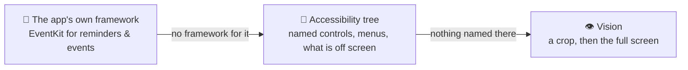

<div align="center">

# J.A.R.V.I.S.

**A voice-first agent that uses your Mac the way a careful person would.**

It reads what is on screen as named controls, says what it is about to do, asks before anything that
matters, acts — and then checks that the action really happened.


[](leanring-buddy)


[](worker)
[](LICENSE)

</div>

> **Not yet:** <!-- not-yet -->reading the calendar through EventKit — events are written through it, but still read from the Calendar window<!-- /not-yet -->

The repository is **Agent-OS**; the app builds as **Clicky**.

---

## 📖 Background

J.A.R.V.I.S. started as a fork of [Clicky](https://github.com/farzaa/clicky) by Farza Majeed — an
open-source menu-bar companion that takes a screenshot, sends it to a vision model, and points at things
on screen. Clicky's shell is still here: the menu-bar panel, the cursor overlay, the voice loop and the
signed app with its macOS permissions.

What changed is how it senses and acts. A screenshot model has to guess pixel coordinates, and nothing
can check a guess afterwards. macOS already describes every window to screen readers as a tree of named
controls with real positions — the **Accessibility tree** — and for many apps it offers a framework that
writes their data directly. J.A.R.V.I.S. uses those first, and pixels last.

## 🧭 Principles

### 🍎 Native first, pixels last

The agent uses the most structured route the Mac offers for a job:



1. **The app's own framework.** When macOS has an API for the job, the agent uses it instead of the app's
   window. Reminders and calendar events are written through **EventKit**, the same store Siri writes to:
   a typed item with a real date, read straight back to confirm what was saved. Driving the Reminders
   window directly lost to the app's own helpfulness — it autocompleted titles from old reminders,
   re-read dates typed into a title (once a year off), and kept a picked date only once the edit ended.
   A direct write has none of those failure modes, and takes one step instead of a dozen.
2. **The Accessibility tree.** Named elements with frames, menus that can be read while closed, and
   knowledge of what is off screen — things the agent can press, wait on and re-read. The tree stays a
   local index: it is never pasted into a model's prompt. The model names a target; local code resolves
   that name to an exact element.
3. **Vision, as the fallback.** A crop of the region in question, then a full capture. A click at a point
   the tree cannot name is allowed only when the text read at that point matches what was asked for.

**Dates and times come from the owner's own words**, parsed on the Mac — never from the model's
rewording. If a time is unclear ("at 5" — morning or evening?) or already past, the agent asks one
question instead of guessing.

### 🧠 Models suggest, local code decides and checks

A model never gets direct control of the machine. It sends a structured request — *"press Save in
TextEdit"* — and local code decides whether it runs, how, and in which app.

An action counts only when the app is seen to change. A success code from the operating system is not
enough, because macOS often reports success for a write that changed nothing. After each action the
agent reads the app again, and a task is **done** only when every claim it makes is backed by a recorded
result. A claim without one is sent back to the model.

### 🛡️ Safety

| | |
|---|---|
| 🗣️ **The owner's words are the only authority** | A task starts only from something the owner said. Text on a web page, in an email or in a document can never start a task or change what it is for. |
| ✋ **Actions that reach other people, money or data ask first** | Sending, deleting and similar actions show an approval card. *Allow* counts only from a real click on the card — another program clicking it does not count. A small change to the owner's own data, such as adding a reminder, does not ask. |
| ⛔ **Irreversible actions are refused outright** | Emptying the bin, erasing, permanent deletion, buying, paying and placing an order have no approval path, because there would be no chance to take them back. |
| 🔐 **Credentials stay with the owner** | The agent never types into a password field. While one is focused it neither types nor takes screenshots, and anything that looks like a secret is blacked out of what leaves the Mac. |
| 🛑 **One file stops everything** | A kill-switch file refuses every action, and a per-app policy can allow, require approval for, or refuse each app. If the policy cannot be read, every action is refused. |
| 📝 **Every request is logged** | Whether it ran or was refused. |

### 🎙️ Voice first

The owner talks; the agent talks back. A realtime voice model handles single steps — opening an app,
pressing a menu item, answering a question about the screen. A goal that takes several steps goes to an
agent loop that makes a short plan, takes one action at a time, and reads the result before choosing the
next. Both paths go through the same safety checks.

### 🔑 No keys in the app

The app holds no API keys. A small Cloudflare Worker in [`worker/`](worker) keeps every provider key as
a secret and forwards the app's requests. It refuses any request without this app's client key, and
refuses everything if that key is not set.

---

## 🛠️ Build and run

You need **macOS 14.2 or later** and **Xcode**. It runs on macOS only and is built from Xcode — there is
no packaged release.

<details>
<summary><b>Step by step</b></summary>

1. Put your own bundle identifier in a new `Signing.local.xcconfig` next to `Signing.xcconfig` (that file
   explains the format). Changing the identifier later means granting every permission again.
2. Open `leanring-buddy.xcodeproj`, choose the `leanring-buddy` scheme and press **⌘R**.
   > ⚠️ **Build from Xcode only.** Building with `xcodebuild` from a terminal makes macOS forget the
   > app's permissions, and they have to be granted again by hand.
3. Grant the permissions the app asks for:
   - **Accessibility** — to read and act on other apps
   - **Screen Recording** — for the vision fallback
   - **Microphone** — for voice
   - **Reminders** and **Calendar** — optional; needed to create reminders and events
4. Set up the worker:

   ```bash
   cd worker
   npx wrangler secret put CLICKY_CLIENT_KEY   # and one secret per provider key you use
   npx wrangler deploy                         # or `npx wrangler dev` to run it locally
   ```

   Then tell the app where the worker is and which client key to send:

   ```bash
   defaults write <your bundle id> ClickyWorkerBaseURL https://<your-worker>.workers.dev
   defaults write <your bundle id> ClickyWorkerClientKey <the same client key>
   ```

Unit tests use Swift Testing and run from Xcode (**⌘U**), or with `scripts/run-tests.sh`, which drives
Xcode's own test action. The other scripts explain themselves in their headers.

</details>

## 🗂️ Layout

| Folder | What lives there |
|---|---|
| [`leanring-buddy/`](leanring-buddy) | The app — the folder name is an old typo, kept on purpose |
| [`leanring-buddyTests/`](leanring-buddyTests) | Unit tests |
| [`worker/`](worker) | The Cloudflare Worker that holds the API keys |
| [`scripts/`](scripts) | Test runners and measurement probes |

## 🙏 Credits

Forked from **[farzaa/clicky](https://github.com/farzaa/clicky)** by Farza Majeed, MIT licensed. The app
shell, companion UI, voice plumbing and the original Clicky idea are his. The structure-first sensor,
native-API actions, safety checks, approvals, verification, the agent loop and the test suites were added
in this fork.

Implementation was AI-assisted. The architecture, the measurements and the debugging were not.

## 📄 License

MIT — see [`LICENSE`](LICENSE). The upstream copyright notice is kept.
